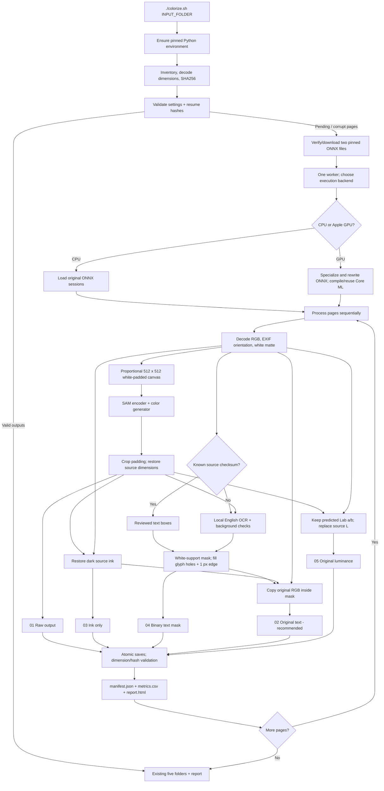

# Current pipeline architecture

This describes active `colorize.sh`, `colorize.py` and `manga_colorizer/` code. The multi-model benchmark runner has been removed. Only model 3 is implemented.

## Model tensors

`model.py` defaults to `CPUExecutionProvider`, four intra-op threads, one inter-op thread, sequential execution and disabled session spinning. `--backend coreml-gpu` uses specialized ONNX copies and `CoreMLExecutionProvider` with `MLProgram`, static shapes, `CPUAndGPU` compute units and cached compilation. Both networks remain resident between pages. The implementation uses Core ML through ONNX Runtime; no MLX/PyTorch conversion or diffusion sampler is involved.

The acceleration preparation in `accelerate.py` folds static shape calculations, replaces 18 six-dimensional SAM window transpose patterns with equivalent four-dimensional patterns, and replaces six generator `Abs(x)` nodes with `max(x, -x)`. This avoids ONNX CPU partitions between Core ML sections. Original downloaded weights stay unchanged; converted graphs, output hashes and compiled models live under `.cache/`. See [acceleration details](acceleration.md).

1. Convert the padded canvas to float32 grayscale `[0,255]`.
2. Resize grayscale/255 to 1024 × 1024, repeat across three channels, and pass `[1,3,1024,1024]` to the real SAM encoder.
3. Feed its first two outputs to generator inputs `sam_level0` and `sam_level1`.
4. Supply `L_bw = grayscale/127.5 - 1`, shape `[1,1,512,512]`, plus a zero `wd14_embedding`, shape `[1,1024]`. WD14 is disabled.
5. Validate finite RGB shape `[1,3,512,512]`, map `[-1,1]` to uint8, crop letterboxing and restore source dimensions.

The publisher describes FastViT-SA36 with DualSemanticSAM guidance and a UNet V6 decoder. This wrapper follows the [published tensor contract](https://huggingface.co/sharky172/manga-light-colorizer/blob/2fb022c4ce55632b7671a1df306f63984928e36a/inference.py). It uses proportional padding, unlike upstream's square stretching, matching our original benchmark. The [model card](https://huggingface.co/sharky172/manga-light-colorizer) recommends the 512-pixel training resolution for faithful colors.

## Variant operations

| Variant | Operation | Preservation |
|---|---|---|
| Raw | Predict RGB, crop and resize | Model colors/shading; text can blur at 512 pixels |
| Ink only | Darken raw toward source; exact source at gray ≤24, feather through 96 | Raw RGB exactly at source gray ≥96; dark source ink exactly at ≤24 |
| Original text | Ink-only base; original RGB where mask is white | Source glyphs/antialias pixels inside mask; ink-only RGB exactly elsewhere |
| Text mask | RGB PNG containing 0 or 255 | White: source copied; black: ink-only retained |
| Original luminance | Replace predicted CIELAB L with source L; retain predicted a/b | Whole-page source brightness, subject to gamut clipping; exact source at gray <18 |

Ink uses `alpha = clip((96-source_gray)/72,0,1)` and `target = min(raw_rgb,source_rgb)`. It blends raw toward that target and never lifts shadows. Full-page luminance replacement also removes model-created shading; it remains a separate comparison.

## Text masks

Reviewed boxes are keyed by source byte checksum, independently of filename. New pages use Tesseract segmentation modes 3 and 11. OCR lines pass confidence, size, source-white coverage and predicted-background checks. OCR selects regions and never renders recognized words.

Within each box, threshold source gray at 230, fill external contours to include dark glyphs enclosed by white halos, and dilate once with a 3 × 3 kernel to capture antialias/JPEG edges. Clip to the box. Gray artwork between floating words remains colored. Reviewed boxes exclude nearby faces/hair. Automatic coverage can miss text and needs inspection.

Whole-bubble component restoration was tried and rejected: open outlines connected white bubbles into hair/faces. The final method does not flood-fill white components across the page.

## Recovery and measurements

The parent holds a project lock, enforces storage limits and supervises a spawned worker over a pipe. Loading and each full image request have a timeout (default 1800 seconds); the parent terminates a timed-out worker. Each OCR pass has a 120-second subprocess timeout. Ordinary page errors are recorded and later pages continue; worker failure/timeout ends the invocation.

The production disk reserve defaults to 2 GiB (`--min-free-gib`), plus estimated bytes for pending writes; it is separate from the model's 300.3 MB of weights. The historical 20 GiB benchmark floor is available as an explicit override. Checks use immediately free filesystem bytes and report measured free space, reserve and estimated writes on failure. macOS purgeable capacity is not counted as immediately free. The reserve is recorded as an operational setting, so changing it does not invalidate existing image results.

Five PNGs are saved atomically, decoded/dimension-checked, hashed, and source checksums checked again. Parent validation confirms outputs before completion. Incomplete or corrupted pages are rerun; complete pages are skipped only when input/settings/output hashes match. Changed inventories/settings require another output folder. Processing timings cover all five saves and validation; model loading is separate. Recorded RSS is the worker's process-lifetime peak and excludes parent/system memory.

The selected backend is an image-processing setting stored in run metadata. Historical runs without a backend field are treated as CPU runs, preserving resume compatibility. Switching CPU/GPU requires another output folder because their results can differ by small floating-point rounding amounts. GPU output is validated for finite values and usable image variation, and explicit GPU initialization failures are surfaced rather than silently reported as accelerated CPU work.
